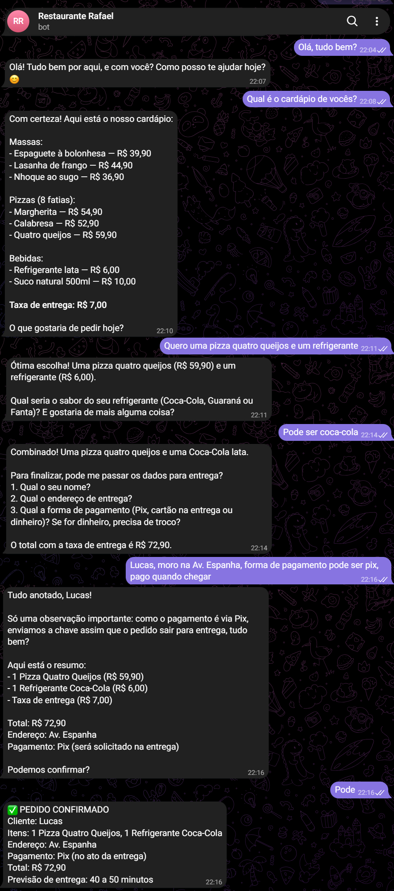
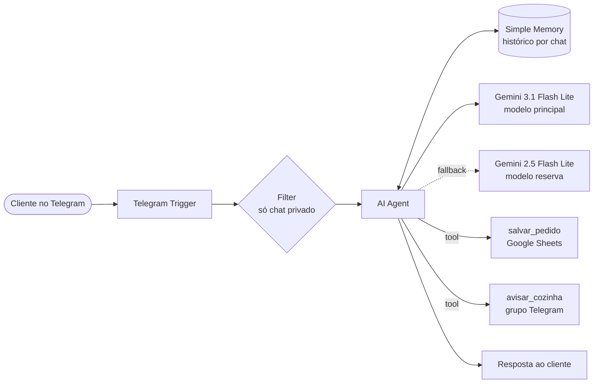
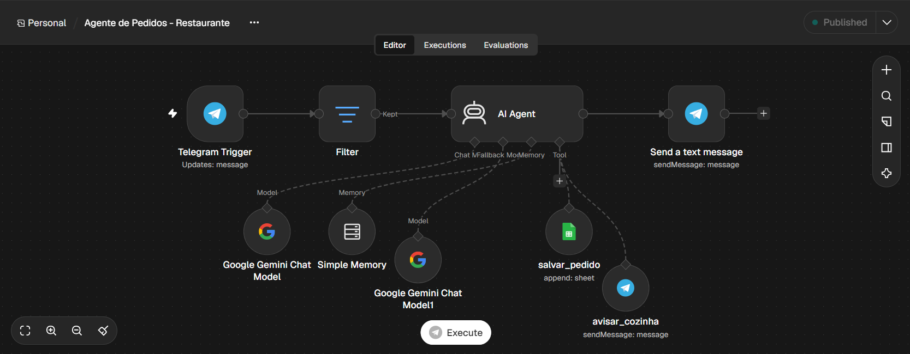
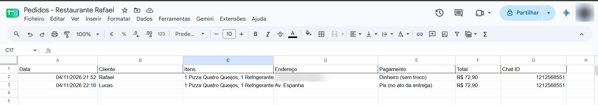
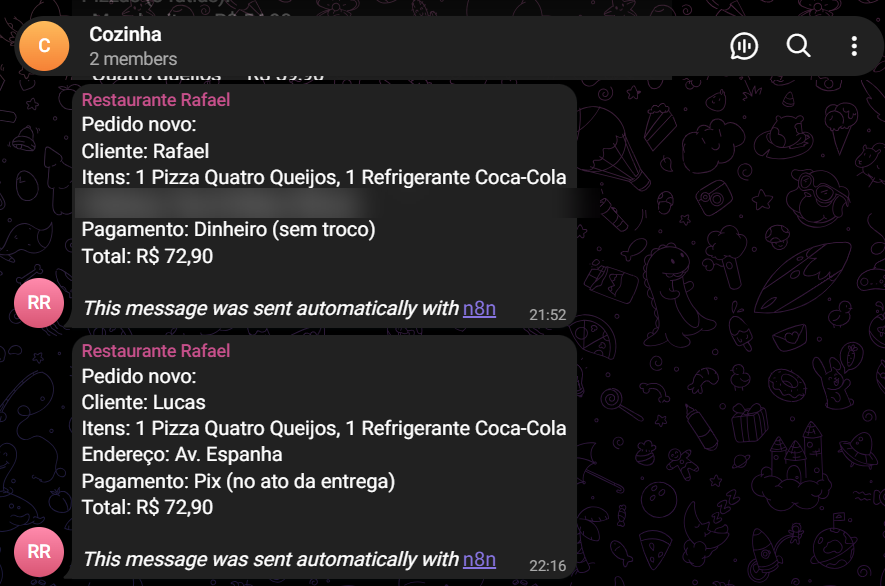

# 🍝 Agente de Pedidos com IA — Restaurante

Um agente de IA que **atende clientes no Telegram, monta o pedido, salva numa planilha e avisa a cozinha**, tudo sem código, com **n8n** e **Google Gemini**.

> Projeto de portfólio. O restaurante e o cardápio são fictícios.

## O problema

Restaurantes de delivery perdem pedidos quando ninguém responde rápido. Pedidos anotados à mão também geram erros: item errado, total errado, endereço esquecido. E a cozinha só fica sabendo do pedido quando alguém repassa.

## A solução

Um atendente virtual que:

- **conversa em linguagem natural** com o cliente e mostra o cardápio;
- **monta o pedido**, pergunta quantidades e **recusa itens que não existem**, sugerindo alternativas;
- coleta **nome, endereço e forma de pagamento**;
- **calcula o total**, incluindo a taxa de entrega, e pede confirmação;
- depois da confirmação, **registra o pedido no Google Sheets** e **envia o resumo para o grupo da cozinha** no Telegram.

## Arquitetura

## Como funciona

1. **Telegram Trigger**: recebe cada mensagem enviada ao bot.
2. **Filter**: deixa passar só conversas privadas, para o agente não responder no grupo da cozinha.
3. **AI Agent**: segue um *system prompt* com o cardápio, os preços e as regras de atendimento.
4. **Simple Memory**: guarda o histórico de cada cliente separado pelo `chat.id`, para o agente lembrar do que já foi pedido.
5. **Ferramentas (tools)**: o próprio agente decide quando usá-las, e só depois que o cliente confirma:
   - `salvar_pedido`: adiciona uma linha na planilha (data, cliente, itens, endereço, pagamento, total, chat ID). Os campos são preenchidos pelo modelo a partir da conversa.
   - `avisar_cozinha`: envia o resumo do pedido para o grupo "Cozinha".
6. **Resposta**: o cliente recebe o "✅ PEDIDO CONFIRMADO" com o resumo e a previsão de entrega.

| Pedido salvo na planilha | Aviso no grupo da cozinha |
|---|---|
|  |  |

## Decisões e aprendizados

- **Modelo de fallback**: durante os testes, a API do Gemini devolveu `503 – high demand` (sobrecarga do lado do Google). Configurei um segundo modelo como reserva, para o agente continuar funcionando quando o principal está indisponível.
- **Ferramentas em vez de fluxo fixo**: em vez de um fluxo com vários "se/então", o agente recebe ferramentas com descrições claras e decide quando usá-las. As regras do prompt garantem que nada é salvo antes da confirmação.
- **Memória por cliente**: a chave da memória é o `chat.id`, para que conversas de clientes diferentes nunca se misturem.
- **Filtro de canal**: o bot faz parte do grupo da cozinha (para enviar avisos), então um filtro impede que mensagens do grupo cheguem ao agente.

## Ferramentas

`n8n` · `Google Gemini API` · `Telegram Bot API` · `Google Sheets` · engenharia de prompt · agentes com ferramentas (tool calling)

## Como rodar

1. Importe `workflow/agente-pedidos.json` no n8n (**Import from file**).
2. Crie as credenciais:
   - **Telegram**: token do bot, gerado no @BotFather.
   - **Google Gemini**: chave do Google AI Studio.
   - **Google Sheets**: login com Google.
3. Crie uma planilha com as colunas `Data | Cliente | Itens | Endereço | Pagamento | Total | Chat ID` e selecione-a no nó `salvar_pedido`.
4. Crie um grupo no Telegram, adicione o bot e coloque o ID do grupo no nó `avisar_cozinha`.
5. Publique o workflow e converse com o bot no chat privado.

O prompt completo do agente está em [`prompts/system-prompt.md`](prompts/system-prompt.md).

## Próximos passos

- [ ] Atender também pelo **WhatsApp** (WhatsApp Business Cloud API), usando o mesmo agente.
- [ ] Consultar o cardápio numa planilha, em vez de deixá-lo fixo no prompt.
- [ ] Avisar o cliente quando o pedido sair para entrega.

---

Feito por **Rafael da Silveira Gonçales** · [LinkedIn](https://www.linkedin.com/in/rafaelgoncales) · [GitHub](https://github.com/Rafael8353)
